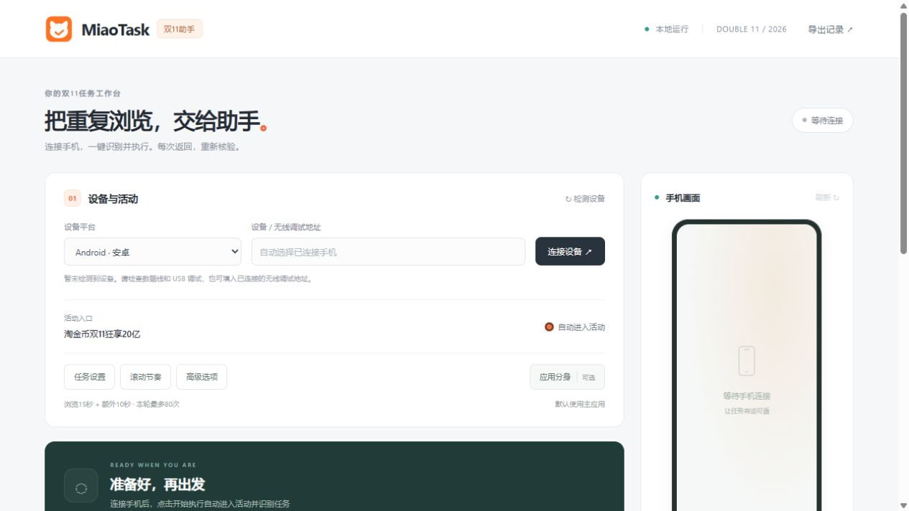
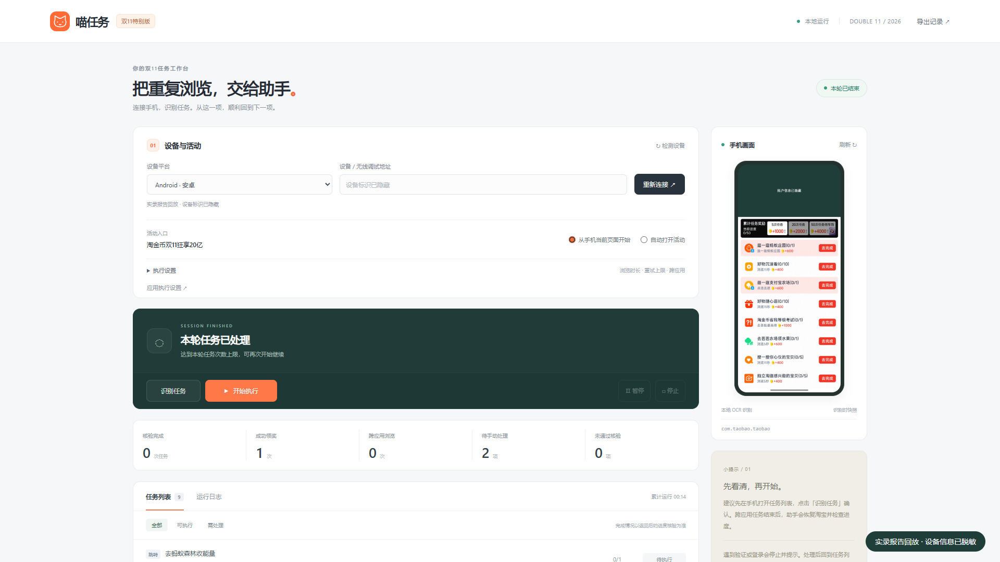

# MiaoTask · 淘宝双11任务助手

在电脑本地网页中管理手机上的浏览、搜索、跳转返回和累计领奖。当前适配 **淘金币双11「狂享20亿 → 赚能量」**：执行前读取任务，返回后核验进度，支持暂停、继续和停止。

**[下载 Windows 便携 ZIP](https://github.com/h0ll0w-AkuZr0guY/tmall-miao-double11/releases/latest)** · **[详细使用说明](PORTABLE_README.md)** · **[v9 更新说明](docs/RELEASE-v20261021-double11.9.md)** · **[开发文档](docs/DEVELOPMENT.md)**

## 下载后怎么用

1. 打开 [Releases](https://github.com/h0ll0w-AkuZr0guY/tmall-miao-double11/releases/latest)，在 **Assets** 下载 Windows x64 ZIP。`Source code` 是开发者使用的源码包。
2. **完整解压**，双击 `MiaoTask.exe`，保留旁边的 `_internal/`。电脑无需另装 Python、ADB 或 OCR 模型，浏览器会自动打开本地控制台。
3. 解锁安卓手机、开启 USB 调试并连接电脑，在手机上允许这台电脑调试，再在网页点击「连接设备」。首次未发现 USB 手机时会尝试兼容连接后端；部分手机仍需厂商 USB 驱动。
4. 保留默认 **「自动进入活动」**，点击 **「开始自动执行」**。助手会定位领淘金币入口、打开赚能量菜单并读取任务；每次重新开始与返回后都会更新任务列表。

初次使用建议在「任务设置」把本轮上限设为 **2次**。默认使用主应用；有多个淘宝时，点击「应用分身」选择实例，或安排顺序执行。无需分身时保持收起即可。

| 设置入口 | 作用 |
| --- | --- |
| 任务设置 | 浏览时长、重试与本轮上限、任务类型、累计领奖 |
| 滚动节奏 | 滑动距离、时长、同方向连续次数及额外间隔的随机范围 |
| 高级选项 | 跨应用返回、OCR、从手机当前页面开始 |
| 应用分身 | 选择主应用或分身、安排串行队列；默认关闭 |

**关闭浏览器不会退出后台。** Windows 右下角 MiaoTask 托盘可双击打开控制台，右键「停止任务并退出助手」；也可用网页底部「退出助手」。升级前先退出旧版，再将新 ZIP 解压到新目录。每日记录保存在用户数据目录，继续保留。

默认网址为 `http://127.0.0.1:8765`，端口冲突时自动换用空闲端口。当前便携包面向 **Windows x64 + Android**；HarmonyOS 保留驱动接口，需另行提供 HDC，尚未完成实机验证。

## 控制台预览

下图为 v9 默认首页的正常桌面视口截图（1265×712），展示未连接设备时的界面，不含手机或账号信息。分身管理和三组设置均默认收起。

历史任务结果与操作视频

以下是 v5 的1920×1080脱敏桌面截图，来自荣耀真机报告回放；用于展示任务、统计和诊断信息，按钮布局以当前 v9 为准。

[历史设置截图](docs/assets/settings-desktop.webp) · [历史任务列表截图](docs/assets/results-desktop.webp)

操作视频介绍 v4 的流程与真实任务结果：[横版 MP4](https://github.com/h0ll0w-AkuZr0guY/tmall-miao-double11/releases/download/v20261019-double11.4/MiaoTask-Guide-PC-1920x1080.mp4) · [竖版 MP4](https://github.com/h0ll0w-AkuZr0guY/tmall-miao-double11/releases/download/v20261019-double11.4/MiaoTask-Guide-Phone-1080x1920.mp4) · [演示说明](docs/DEMO.md)。它们不代表 v9 新功能的连续实录。

## 与 MonsterNone/tmall-miao next 的关系

基于 [MonsterNone/tmall-miao 的 next 分支](https://github.com/MonsterNone/tmall-miao/tree/9318d3d138d5fa53cff00601740de012da831c65)改造，感谢原作者及贡献者。下表以上述来源提交为基准，不代表上游之后的版本；权利归属见 [来源说明](ATTRIBUTION.md)。

| 方面 | 上游 next 来源版本 | MiaoTask |
| --- | --- | --- |
| 活动 | 2026年618淘金币、红包能量任务 | 双11淘金币赚能量任务 |
| 操作与分发 | 命令行菜单；已有 Windows 打包，包含 ADB / HDC | 本地网页与 CLI；Windows ZIP 包含 Android 环境、离线 OCR 和自检 |
| 识别与核验 | 按活动脚本、控件与预设流程执行 | UI 树 + 本地 OCR；持续滚动，返回后核验进度 |
| 搜索与返回 | 按对应活动流程进入和返回 | 原生填字与提交冗余；跨应用有限返回、必要时恢复所选淘宝 |
| 实例与记录 | 以来源脚本流程为入口 | 主应用/分身选择与串行队列，按设备、实例、日期隔离记录 |
| 操作反馈 | 控制台输出 | 手机预览、任务状态、今日累计、失败现场和诊断导出 |

## 已完成与待办

| 状态 | 内容 |
| --- | --- |
| ✅ v3–v4 | 双11任务解析、滚动浏览、搜索结果确认、跨应用访问、动态任务、累计领奖、本地控制台与便携包 |
| ✅ v5–v8 | 一键识别执行、每日记录、首次连接兼容、人工认证提醒、冷启动与赚能量菜单兜底、截图及 OCR 缓存 |
| ✅ v9 | 淘宝分身选择与串行队列、实例隔离、随机滚动参数、Windows 托盘、统一图标与折叠设置 |
| ⏳ 持续适配 | 新活动页面、复杂跳转与弹窗、不同账号任务及更多认证提示 |
| ⏳ 待验证 | HarmonyOS 实机、更多厂商分身和第三方容器 |
| ⏳ v10 规划 | 调整项目架构，便于适配更多应用与活动；结构方案待确定 |

完整进展见 [ROADMAP](docs/ROADMAP.md)。游戏、拉人、助力、金币考试与真实交易不自动执行。已有处理路径不保证所有机型、账号和页面都能完成。

## 统计、反馈与风险

统计及已确认不可用任务按 **设备 + 淘宝实例 + 自然日**保存在本机；同日重开继续累计，第二天重新判断应用可用性。不同分身独立，同一实例内手动换账号仍共用当天记录。网页同时展示「今日累计」和「本轮」。

失败时可在「失败现场与反馈」查看固定目录、导出当日诊断 ZIP。反馈请附版本、手机型号、系统版本、任务名称及脱敏截图。**原图可能含昵称、金额、设备码和搜索历史，分享前请检查；不会自动上传。**

检测到安全认证会停止、保存现场并弹出 Windows 提醒，请本人在手机处理后重新开始。程序不自动破解认证。截图和 OCR 在本机处理；USB 调试具有手机操作权限，页面变化可能误点，平台也可能限制自动化，不保证奖励或账号安全。见 [风险与权限](docs/SAFETY.md)、[数据与隐私](docs/PRIVACY.md)。

源码运行见 [DEVELOPMENT](docs/DEVELOPMENT.md)；另有 [架构设计](docs/ARCHITECTURE.md)、[版本变化](CHANGELOG.md)、[构建发布](RELEASING.md)、[图标规格](docs/BRAND.md)。
