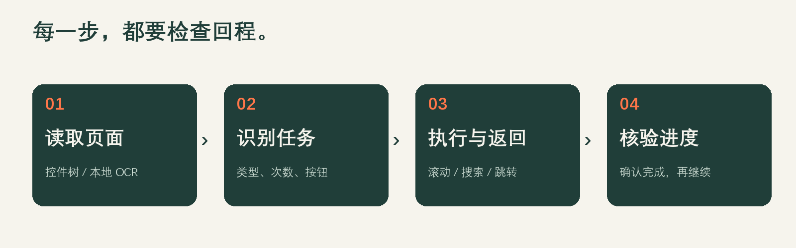

# 喵任务 · 淘宝双11任务助手

把手机上重复的浏览、搜索和返回操作放到本地控制台中管理。当前适配 **淘金币双11「狂享20亿 → 赚能量」**，每次返回检查任务进度，支持暂停、继续和停止。

**[下载 Windows 便携版](https://github.com/h0ll0w-AkuZr0guY/tmall-miao-double11/releases/latest)** · **[操作演示与宣传素材](docs/DEMO.md)** · **[详细使用说明](PORTABLE_README.md)**

3分27秒操作演示：**[横版 MP4](https://github.com/h0ll0w-AkuZr0guY/tmall-miao-double11/releases/download/v20261019-double11.4/MiaoTask-Guide-PC-1920x1080.mp4)** · **[竖版 MP4](https://github.com/h0ll0w-AkuZr0guY/tmall-miao-double11/releases/download/v20261019-double11.4/MiaoTask-Guide-Phone-1080x1920.mp4)** · **[封面、字幕与素材包](https://github.com/h0ll0w-AkuZr0guY/tmall-miao-double11/releases/download/v20261019-double11.4/MiaoTask-Promo-20261019.zip)**

## 页面长什么样

下图使用 **1920×1080 正常桌面视口**，保留控制台的桌面布局。内容来自当天实录报告回放，设备标识已隐藏；右侧为识别阶段的手机快照，与报告结果并非同一时刻。

展开查看执行设置与任务列表（桌面原尺寸截图）

## 能做什么

| 功能 | 处理方式 |
| --- | --- |
| 浏览任务 | 持续上下滚动；15秒任务默认计划停留约27秒，可调整缓冲 |
| 搜索任务 | 填写原生输入框，点击搜索，确认结果页后计时；不安装或切换输入法 |
| 跳转与新任务 | 尝试跨应用访问、恢复淘宝；返回后重新识别替换出的任务 |
| 核验与领奖 | 检查次数、完成状态和对应累计奖励卡，不把跳转次数当完成数 |
| 控制执行范围 | 按浏览、搜索、跳转、累计领奖选择本轮类型，限制次数与重试 |

游戏、拉人、金币考试以及支付、下单等交互留待手动处理。缺失应用依据该手机的实际反馈判断，不预设他人的安装情况。活动页面会变化，部分任务可能无法通过核验。

## 三步开始

1. 在 [Releases](https://github.com/h0ll0w-AkuZr0guY/tmall-miao-double11/releases/latest) 下载 Windows x64 ZIP，**完整解压**，双击 `MiaoTask.exe`。保留同目录的 `_internal/`，电脑无需自行安装 Python、ADB 或模型。
2. 解锁安卓手机、开启 USB 调试，连接电脑并在手机确认授权。网页点击「连接设备」。部分手机需要厂商 USB 驱动。
3. 选择「自动打开活动」并识别任务；也可以手动进入「淘宝 → 领淘金币 → 赚能量」，选择「从当前页面开始」。检查列表和设置后开始执行。

控制台默认 `http://127.0.0.1:8765`，端口被占用时自动换用空闲端口。升级前在旧网页底部点击「退出助手」；只关闭浏览器不会停止后台。初次使用建议将本轮上限设为2次。

当前便携版面向 **Windows x64 + Android**。HarmonyOS 驱动接口保留，需自行提供 HDC，尚未完成鸿蒙实机验证。

## 如何工作与使用风险

UI 控件树与本地 OCR 共同读取页面；截图识别在本机处理，网页仅监听本机地址。右侧是定期截图预览。USB 调试具有手机操作权限，页面变化也可能误点；日志、录屏应脱敏后再分享。平台可能限制未经授权的自动化，**不保证奖励或账号安全**。详见 [风险与权限说明](docs/SAFETY.md)、[本地数据与隐私](docs/PRIVACY.md)。

## 项目来源与文档

基于 [MonsterNone/tmall-miao](https://github.com/MonsterNone/tmall-miao) 的 `next` 分支改造，感谢原作者及贡献者。独立维护双11执行流程、本地网页控制台和便携包；保留上游设备适配与打包基础的来源说明。

[版本变化](CHANGELOG.md) · [与原版的差异及架构](docs/ARCHITECTURE.md) · [源码运行与二次开发](docs/DEVELOPMENT.md) · [构建发布](RELEASING.md) · [来源及权利说明](ATTRIBUTION.md)
