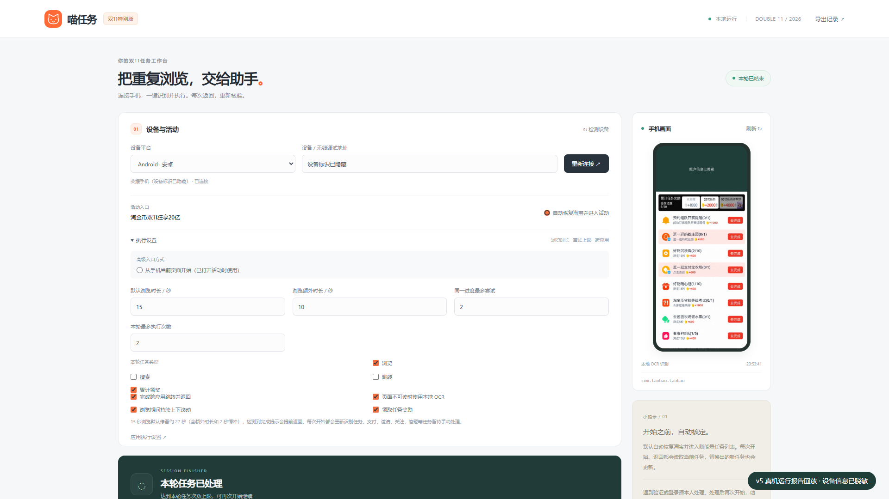
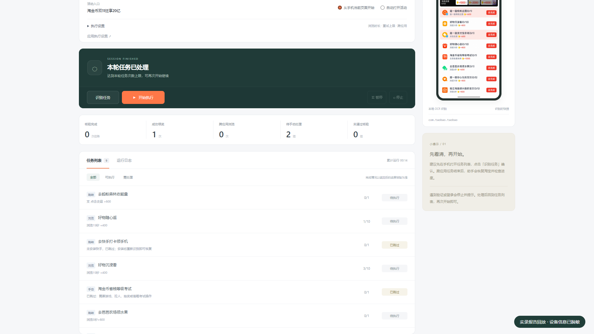

# 喵任务 · 淘宝双11任务助手

在电脑本地网页中管理手机上的浏览、搜索、跳转返回和累计领奖。当前面向 **淘金币双11「狂享20亿 → 赚能量」**：执行前识别当前任务，返回后核验进度，支持暂停、继续和停止。

**[下载 Windows 便携 ZIP](https://github.com/h0ll0w-AkuZr0guY/tmall-miao-double11/releases/latest)** · **[详细使用说明](PORTABLE_README.md)** · **[开发文档](docs/DEVELOPMENT.md)** · **[完成情况与待办](docs/ROADMAP.md)**

## 下载后怎么用

1. 打开 [Releases](https://github.com/h0ll0w-AkuZr0guY/tmall-miao-double11/releases/latest)，在 **Assets** 下载 Windows x64 便携 ZIP。`Source code` 是源码包，需要自行配置环境。
2. **完整解压** ZIP，双击 `MiaoTask.exe`。保留旁边的 `_internal/`，电脑无需另装 Python、ADB 或 OCR 模型，浏览器会自动打开控制台。
3. 解锁安卓手机，开启 USB 调试，用数据线连接电脑，网页点击「连接设备」，助手会触发并等待手机上的 USB 调试授权提示，由本人点允许。首次未发现 USB 手机时会尝试兼容连接后端。只有一台手机时会自动选择；多台设备需先选择。部分手机需要厂商 USB 驱动。
4. 保持默认 **「自动恢复淘宝并进入活动」**，点击 **「开始自动执行」**。助手会定位活动、打开任务菜单、识别后执行；每次重新开始都会刷新任务列表。

初次使用可在「执行设置」将本轮上限改为 **2次**。暂停后可继续，停止后可重新开始。检测到安全验证会停止并弹出 Windows 提醒，请本人在手机处理后再点击开始；关闭提醒不会自动继续。普通页面异常优先关闭并重开淘宝、重读任务列表，每次任务尝试最多冷重启一次。登录、授权或支付提示仍需本人处理。

默认网址为 `http://127.0.0.1:8765`，端口冲突时自动换用空闲端口。**关闭网页不会停止后台**，退出或升级时请点击网页底部「退出助手」。当前便携包面向 **Windows x64 + Android**；HarmonyOS 保留驱动接口，HDC 需自行提供，尚未完成鸿蒙实机验证。

## 控制台预览

以下是 **1920×1080 正常桌面视口**的脱敏截图，保留电脑布局。截图使用 v20261019-double11.5 当天荣耀手机真机运行报告回放，展示设备日累计与本轮结果；右侧为同轮结束后的手机快照。设备标识及账户区域已遮挡。

展开执行设置与任务列表（桌面原尺寸截图）

操作视频介绍 v20261019-double11.4 的流程与真实任务结果，新版按钮以当前控制台为准：**[横版 MP4](https://github.com/h0ll0w-AkuZr0guY/tmall-miao-double11/releases/download/v20261019-double11.4/MiaoTask-Guide-PC-1920x1080.mp4)** · **[竖版 MP4](https://github.com/h0ll0w-AkuZr0guY/tmall-miao-double11/releases/download/v20261019-double11.4/MiaoTask-Guide-Phone-1080x1920.mp4)** · **[演示说明](docs/DEMO.md)**

## 与 MonsterNone/tmall-miao next 的关系

基于 [MonsterNone/tmall-miao 的 next 分支](https://github.com/MonsterNone/tmall-miao/tree/9318d3d138d5fa53cff00601740de012da831c65)改造，感谢原作者及贡献者。下表以上述来源提交为比较基准，不代表上游之后的版本；权利归属见 [来源说明](ATTRIBUTION.md)。

| 方面 | 上游 next 来源版本 | 本项目 |
| --- | --- | --- |
| 活动 | 2026年618淘金币、红包能量任务 | 聚焦双11淘金币赚能量任务 |
| 入口与分发 | 命令行菜单；已有 Windows 打包运行，包含 ADB / HDC | 本地网页控制台 + CLI；Windows ZIP 包含 Android 环境、离线 OCR 和自检 |
| 识别与浏览 | 活动脚本按控件、文本及预设流程执行 | UI 树 + 本地 OCR；持续滚动、完成提示检测与返回后的进度核验 |
| 搜索与返回 | 按对应活动页面流程进入和返回 | 原生输入框填固定文字，定位右侧搜索按钮并确认结果页；跨应用返回失败时重新定位活动 |
| 中断后继续 | 以脚本的活动流程为入口 | 一键重新识别并执行；当日同设备统计及已确认不可用任务保存在本机 |
| 诊断与反馈 | 控制台输出 | 网页任务结果、运行日志、失败截图与当日诊断包 |

## 已完成与待办

| 状态 | 内容 |
| --- | --- |
| ✅ 前版已实现 | 双11任务解析、持续滚动浏览、搜索结果确认、跨应用访问、动态新任务、累计领奖、有限重试、本地控制台与便携包 |
| ✅ 本次实现 | 合并识别与执行、默认自动定位活动与恢复兜底、预览提速、设备当日日志与统计、当天不可用任务缓存、失败现场导出、搜索提交冗余 |
| ✅ v6 修复 | 赚能量菜单确认、有限补点、官方搜索卡片入口与超时边界；普通异常冷重启后重新识别 |
| ✅ v7 修复 | 冷启动等待开屏结束，优先首页领淘金币；进入活动后等待赚能量可用，确认「做任务赚能量」标题和任务行均出现再执行；加载中不返回或点击标题 |
| ✅ 人工验证提示 | 已有滑块与图片拖放现场；识别后停止、保存证据并弹出 Windows 提醒，由本人处理 |
| ⏳ 持续适配 | 新活动入口、复杂跳转链路、弹窗和不同账号页面；新增案例后继续补充验证 |
| ⏳ 待验证 | HarmonyOS 实机、分身应用及更多机型 |

完整范围、版本进展和复现方式见 [ROADMAP](docs/ROADMAP.md)。已实现表示已有对应处理路径，**不保证每个账号、机型或活动页面都能完成**。游戏、拉人、金币考试与真实交易不自动执行。

## 统计、反馈与风险

统计与已确认不可用任务按 **设备 + 自然日**保存在本机；当天重新连接或重开助手会继续累计，第二天重新判断应用可用性。网页同时区分「今日累计」与「本轮」。同一设备切换淘宝账号仍共用当天统计。

失败现场放在固定的设备当日目录，可在「失败现场与反馈」查看路径、导出诊断 ZIP。**诊断包可能包含手机个人页面**，提交 Issue 前请检查、遮挡昵称、余额、设备码和搜索历史；不会自动上传。

截图与 OCR 在本机处理，网页仅监听本机地址。USB 调试允许电脑操作手机，页面变化可能误点，平台也可能限制未经授权的自动化。项目不保证奖励或账号安全。详见 [风险与权限](docs/SAFETY.md)、[本地数据与隐私](docs/PRIVACY.md)。

源码运行与二次开发请看 [DEVELOPMENT](docs/DEVELOPMENT.md)；另有 [架构设计](docs/ARCHITECTURE.md)、[版本变化](CHANGELOG.md) 和 [构建发布](RELEASING.md)。
