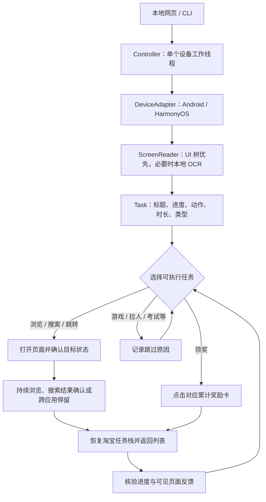

# 双11改造与架构设计

本项目基于 [MonsterNone/tmall-miao 的 next 分支](https://github.com/MonsterNone/tmall-miao/tree/9318d3d138d5fa53cff00601740de012da831c65)改造，
保留并修改设备适配和搜索入口，围绕双11任务流程重写执行器。

## 与上游版本的差异

| 方面 | 上游 next 分支 | 本版本 |
| --- | --- | --- |
| 活动范围 | 618 淘宝及京东的多种活动脚本 | 淘宝双11淘金币「赚能量」；清除未接入的旧京东和618模块 |
| 操作入口 | 命令行交互菜单 | 本地 HTML 控制台，兼容 CLI 和 `modules.taobao.run` |
| 页面识别 | XPath、控件文本及页面资源标识 | UI 树优先，按行位置配对标题、次数和按钮；不可读时本地 OCR |
| 浏览策略 | 浏览流程使用固定等待时间 | 读取任务秒数，默认额外10秒及2秒缓冲，持续上下滚动，完成提示可提前结束 |
| 完成依据 | 浏览流程等待后返回 | 返回后核验进度、完成标签、对应奖励卡或可见任务行变化 |
| 搜索任务 | 根据搜索建议和商品资源标识进入 | 原生输入框填字、明确点击提交按钮、确认结果页后计时 |
| 跨应用返回 | 常规返回逻辑 | 保存原应用包名，恢复淘宝任务栈并按页面反馈重开列表 |
| 失败处理 | 按预设任务类型循环寻找 | 按任务与进度限制重试；实际跳转失败后记录本机跳过原因 |
| 新任务 | 以预设任务查找方式处理 | 每次返回重新解析；替换任务拥有独立身份，避免继承旧任务的重试额度 |
| 分发 | 上游已有打包工具和运行时打包思路 | 新增离线 OCR 模型、锁定环境、源码提交号、自检与 SHA256 发布校验 |

## 执行流程

### 页面观察与任务身份

`screen_reader.py` 统一 UI 树与 OCR 文本为带坐标的 `TextNode`；`task_model.py` 将右侧按钮与同一行的说明配对。
标题、次数和按钮齐全时才执行。聚合控件描述和 OCR 分行结果使用同一规范化逻辑。
可重复任务的商品文案变化时尽量保持身份；一次性入口换成新任务时分配新身份，即使复用了图标也不继承旧失败次数。

### 浏览、搜索与核验

浏览使用任务要求的秒数，增加可配置缓冲并持续滚动。搜索必须确认进入结果页才启动浏览计时。
Android 使用原生可编辑控件 `set_text`，避免输入法安装、切换及广播重试的副作用。
返回时先核验次数、完成标签或奖励状态。控件树保留旧行时用 OCR 复查实际画面。
累计计数达到上限后，末次任务消失还需检查固定奖励栏和相邻任务的位置变化，避免将单纯滚出屏幕视为完成。
累计奖励要求对应卡片显示「已领取」。

### 跨应用与跳过记录

跨应用跳转结束后恢复原淘宝任务栈，按观察到的页面决定是否返回或打开任务面板。
首次正常尝试跳转；遇到安装页、应用商店或核验失败后，结合该手机的安装列表记录原因。
跳过记录只属于当前设备会话，重新连接清除；新用户和新启动的助手不继承开发者设备的结论。
「去支付宝抽红包」等入口若明确写「跳转得奖励」，只进行跳转浏览和返回，不点击内部抽奖。

### 有限执行与本地控制台

同一任务同一进度默认最多尝试2次；返回层数、页面等待、列表滚动及每轮次数均有限制。
一个工作线程拥有设备操作，前端轮询状态并提供暂停、继续和停止。
HTTP 仅绑定 `127.0.0.1`，写操作校验 Host、Origin 和会话令牌；第二次启动复用已有助手。
截图与 OCR 在本机处理。日志、截图和设备信息的公开边界见 [PRIVACY.md](PRIVACY.md)。

## 模块与发布

| 路径 | 职责 |
| --- | --- |
| `main.py` | 网页 / CLI 入口、日志和冻结运行时初始化 |
| `modules/campaign.py` | 观察、执行、返回、核验、重试和跳过 |
| `modules/task_model.py` | 纯任务解析与分类 |
| `modules/screen_reader.py` | UI / OCR 统一观察层 |
| `modules/device_adapter.py` | 手机驱动适配与原生输入 |
| `modules/control_panel.py` | 本地 API、状态快照和单工作线程 |
| `web/` | 无额外前端构建依赖的 HTML / CSS / JavaScript |
| `configs/double11.json` | 公共活动规则与执行上限，不保存设备标识 |
| `scripts/` | 公共文件审计、构建、自检和官方 ADB 获取 |
| `tests/` | 任务解析、流程状态、控制接口和发布边界测试 |

发布使用 Windows x64 / Python 3.13 的锁定依赖环境。PyInstaller 只收集当前入口可达代码与明确声明的资源，
生成独立新目录并执行不连接手机的离线自检，再打包 ZIP、校验文件及源码提交号。
当前默认包面向 Android，包含 ADB；HarmonyOS 驱动保留，HDC 需另行提供，尚未完成鸿蒙实机验证。
