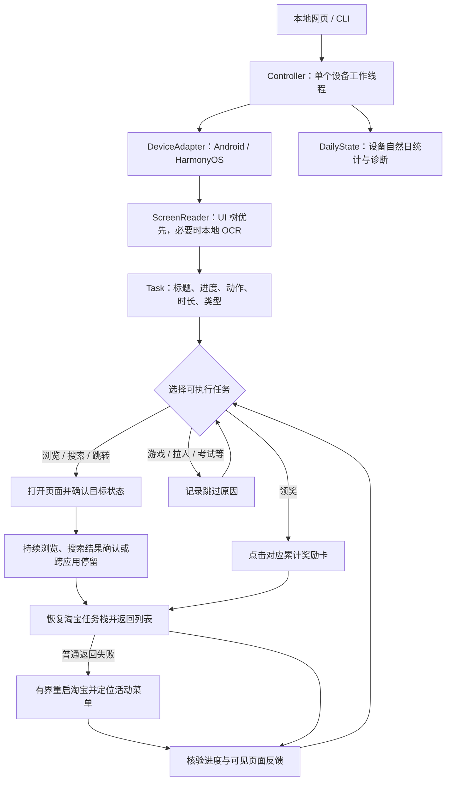

# 双11改造与架构设计

本项目基于 [MonsterNone/tmall-miao 的 next 分支](https://github.com/MonsterNone/tmall-miao/tree/9318d3d138d5fa53cff00601740de012da831c65)改造，
保留并修改设备适配和搜索入口，围绕双11任务流程重写执行器。

## 与上游版本的差异

| 方面 | 上游 next 分支 | 本版本 |
| --- | --- | --- |
| 活动范围 | 618 淘宝及京东的多种活动脚本 | 淘宝双11淘金币「赚能量」；清除未接入的旧京东和618模块 |
| 操作入口 | 命令行交互菜单 | 本地 HTML 控制台一键识别并执行，兼容 CLI 和 `modules.taobao.run` |
| 页面识别 | XPath、控件文本及页面资源标识 | UI 树优先，按行位置配对标题、次数和按钮；不可读时本地 OCR |
| 浏览策略 | 浏览流程使用固定等待时间 | 读取任务秒数，默认额外10秒及2秒缓冲，持续上下滚动，完成提示可提前结束 |
| 完成依据 | 浏览流程等待后返回 | 返回后核验进度、完成标签、对应奖励卡或可见任务行变化 |
| 搜索任务 | 根据搜索建议和商品资源标识进入 | 原生输入框填固定文字，优先右侧搜索按钮，必要时回车；确认结果页后计时 |
| 跨应用返回 | 常规返回逻辑 | 保存原应用包名，恢复任务栈；失败时尝试重开淘宝并定位活动菜单 |
| 失败处理 | 按预设任务类型循环寻找 | 有限重试；设备当日不可用记录、失败说明与截图 |
| 新任务 | 以预设任务查找方式处理 | 每次返回重新解析；替换任务拥有独立身份，避免继承旧任务的重试额度 |
| 分发 | 上游已提供 Windows 打包运行并包含 ADB / HDC | 新增本地网页与离线 OCR、锁定环境、源码提交号、自检与便携 ZIP |

## 执行流程

### 页面观察与任务身份

`screen_reader.py` 统一 UI 树与 OCR 文本为带坐标的 `TextNode`；`task_model.py` 将右侧按钮与同一行的说明配对。
标题、次数和按钮齐全时才执行。聚合控件描述和 OCR 分行结果使用同一规范化逻辑。
可重复任务的商品文案变化时尽量保持身份；一次性入口换成新任务时分配新身份，即使复用了图标也不继承旧失败次数。

### 浏览、搜索与核验

浏览使用任务要求的秒数，增加可配置缓冲并持续滚动。搜索必须确认进入结果页才启动浏览计时。
Android 使用原生可编辑控件 `set_text`，避免输入法安装、切换及广播重试的副作用。采用固定搜索文字，未聚焦时仅在唯一原生输入框上填字；填字后重新读取并定位右侧提交按钮，避免展开奖励栏后沿用旧坐标或点击输入框内的「搜索」提示。按钮提交未确认时可尝试回车，但仍须核对实际结果页。活动内嵌商品列表还会结合浏览奖励条与多个商品价格确认结果页。
返回时先核验次数、完成标签或奖励状态。控件树保留旧行时用 OCR 复查实际画面。
累计计数达到上限后，末次任务消失还需检查固定奖励栏和相邻任务的位置变化，避免将单纯滚出屏幕视为完成。
累计奖励要求对应卡片显示「已领取」。

### 跨应用与跳过记录

跨应用跳转结束后恢复原淘宝任务栈，按观察到的页面决定是否返回或打开任务面板。受限返回失败时，尝试关闭并重新启动淘宝，再从活动入口或活动搜索进入赚能量菜单；各步骤限制次数，无法确认时停止并保存现场。
首次正常尝试跳转；遇到安装页、应用商店或核验失败后，结合该手机的安装列表记录原因。
确认不可用的跳过事实按设备和自然日保存，重新连接或重开助手会加载当天记录，次日重新判断。不同设备的记录隔离，发布包不携带任何真实设备的结论。
「去支付宝抽红包」等入口若明确写「跳转得奖励」，只进行跳转浏览和返回，不点击内部抽奖。

### 设备当日统计与失败现场

Android 首次连接通过 `adb_transport.py` 使用统一 ADB 路径发现设备；Windows 无设备时尝试 libusb 后端，触发握手并等待用户在手机确认授权，不自动批准，也不修改私钥或驱动。已有设备、离线或未授权设备存在时不主动重启服务。

`daily_state.py` 使用解析后的设备类型及真实标识生成16位哈希目录键，在本地数据根目录下按 `daily/YYYY-MM-DD/<device_key>/` 隔离记录。
`state.json` 以临时文件替换方式保存统计与不可用任务，`events.jsonl` 逐条追加日志，`failures/` 保存失败说明 JSON 和可取得的手机 PNG。
目录名与文字日志不直接使用设备序列号；截图仍可能含个人信息，需分享前检查。

每个执行轮次拥有独立 ID，按本轮累计计数的增量更新当天统计，扫描不增加执行次数。页面将今日累计与本轮摘要分开显示；跳过任务按任务键去重，不因每次重新扫描重复累加。跨日时切换记录，避免将前一天已完成次数计入新一天。
统计以设备为单位，同一设备切换淘宝账号共用当天数据。`/api/diagnostics` 只导出当前设备当天的记录和失败现场，下载后不会自动上传。

### 有限执行与本地控制台

同一任务同一进度默认最多尝试2次；返回层数、页面等待、列表滚动及每轮次数均有限制。
一个工作线程执行任务，截图预览线程通过设备 I/O 锁在空闲时读取截图，避免和操作互相抢占。截图目标间隔约0.9秒，实际受设备调用耗时影响。
赚能量入口使用前台文字定位，必要时补读原生菜单控件；点击后以真实截图中的任务列表确认，未响应时最多补点两次。搜索官方活动卡片优先选择与活动描述对齐的右侧「进入」，不将同名搜索框当作入口；列表读取跨过超时边界时仍先检查最后一帧。
普通任务异常优先冷重启淘宝后重新定位，单次任务尝试中的各个恢复调用共用一次冷重启额度；恢复后按当前列表核验已结算进度。认证、登录、授权及支付使用独立的人工处理异常，不进入普通恢复。Windows 认证提醒通过独立守护线程调用原生提示框，去重且不阻塞本地服务器，关闭提示不触发继续。已保存现场的异常带有标记，外层不重复截图。
前端每约0.8秒读取状态，仅在截图序号变化且上一张已加载后替换图片；隐藏标签减少轮询并暂停图片拉取。开始按钮统一发送执行请求，执行前重新定位和识别，保留扫描 API / CLI 用于诊断。
HTTP 仅绑定 `127.0.0.1`，写操作校验 Host、Origin 和会话令牌；第二次启动复用已有助手。
截图与 OCR 在本机处理。日志、截图和设备信息的公开边界见 [PRIVACY.md](PRIVACY.md)。

## 模块与发布

| 路径 | 职责 |
| --- | --- |
| `main.py` | 网页 / CLI 入口、日志和冻结运行时初始化 |
| `modules/campaign.py` | 观察、执行、返回、核验、重试和跳过 |
| `modules/task_model.py` | 纯任务解析与分类 |
| `modules/screen_reader.py` | UI / OCR 统一观察层 |
| `modules/adb_transport.py` | Android 设备发现、首连授权等待与 Windows 兼容后端 |
| `modules/device_adapter.py` | 手机驱动适配与原生输入 |
| `modules/control_panel.py` | 本地 API、状态快照和单工作线程 |
| `modules/daily_state.py` | 设备当日统计、不可用事实、日志与失败现场导出 |
| `web/` | 无额外前端构建依赖的 HTML / CSS / JavaScript |
| `configs/double11.json` | 公共活动规则与执行上限，不保存设备标识 |
| `scripts/` | 公共文件审计、构建、自检和官方 ADB 获取 |
| `tests/` | 任务解析、流程状态、控制接口和发布边界测试 |

发布使用 Windows x64 / Python 3.13 的锁定依赖环境。PyInstaller 只收集当前入口可达代码与明确声明的资源，
生成独立新目录并执行不连接手机的离线自检，再打包 ZIP、校验文件及源码提交号。
当前默认包面向 Android，包含 ADB；HarmonyOS 驱动保留，HDC 需另行提供，尚未完成鸿蒙实机验证。

### 前台确认与本轮类型选择

活动页可能保留弹层背后的控件树。进入、离开和恢复等关键节点按配置用本地 OCR 确认前台，聚合任务行优先采用自身标题和描述，避免背景商品污染分类。`enabled_task_kinds` 决定本轮的浏览、搜索、跳转、累计领奖范围；未勾选的任务临时禁用，不写入设备应用缺失缓存，下一轮调整即可恢复。
